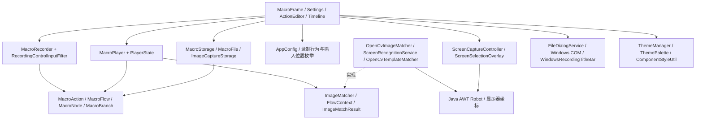

# Macro Recorder 代码质量与架构审查报告

审查日期：2026-10-19。对象：`..` 当前工作区，包含尚未提交的最新代码。

**结论：本轮审查交付已完成。** 人工架构审查、定向诊断和基础测试已完成；恢复后的 IntelliJ IDEA 本地 Qodana 扫描也已取得正式 SARIF，按项目现有 `qodana.starter` 输出 37 条结果（High 23、Moderate 14）。人工确认的功能/测试机制问题仍为 11 项：P1 两项、P2 九项，没有证据充分的 P0；Qodana 结果中的误报和可选 P3 建议单独处理，不与这 11 项混算。本轮没有修复业务代码。扫描配置及安全分析覆盖限制见第 2 节。

## 1. 范围、工作区与环境

### 1.1 工作区保护

- 当前分支 `main`，基准提交 `db3f9c1`，首次提交标题为“首次提交：Macro Recorder 桌面宏工具与中文文档”。现有远程配置和历史未修改。
- 工作区原本存在 13 个已跟踪文件的未暂存修改，以及已暂存的新 `qodana.yaml`。另有录制控制栏文档、新配置枚举、录制过滤器、原生标题栏及相关测试等未跟踪文件，均保留。
- 用户备份 `src (2).zip` 未作为审查源码；本轮没有覆盖、删除或解压它。后续工作区出现的其他用户文件亦未改动。
- 对 97 个源码、测试和关键项目文件保存了 SHA-256 清单。恢复工作后与清单核对，变化数为 **0**；因此已有构建与诊断结果仍对应当前源码。
- 只新增本报告、Qodana 逐项复核附录及 `target/audit-2026-10-18/` 下的隔离审查产物；未提交、推送、创建 PR、重设 Git、清理工作区或启动自动化任务。IDE 本地运行正常更新了被忽略的 `.idea/workspace.xml` 中的报告引用，未改项目构建配置。
- 根目录个人 `config.properties` 的当前哈希与审查最初记录不同，文件最后修改时间为 2026-10-19 13:43。本轮显式测试及故障注入均采用隔离配置，未写入或恢复该个人文件；无法仅凭哈希确定外部修改原因，保留其当前状态，不宣称个人配置全程不变。

工作区原始状态见 [git-status-before.txt](../target/audit-2026-10-18/git-status-before.txt)，文件保全核对见 [preservation-check.json](../target/audit-2026-10-18/preservation-check.json)。

### 1.2 工具与项目

| 项目 | 实际情况 |
| --- | --- |
| 系统 | Windows 11；本轮未重新进行 100%/150% DPI 真实桌面验收 |
| Java | Oracle Java 17.0.14，`D:\jdk17` |
| Maven | 3.9.5；项目设置 `maven.compiler.release=17`、UTF-8 |
| 应用 Maven 版本 | `1.1.0-beta` |
| IntelliJ IDEA | 实际产品版本 2026.2.3，IU build 262.10968.63；安装目录名仍含 2026.1.1 |
| 代码规模 | 主代码 74 个 Java 文件、18,077 物理行；测试 16 个 Java 文件、2,928 物理行 |
| Qodana CLI | PATH 中不可用 |
| Docker | CLI 29.6.1 存在；`desktop-linux` 引擎管道不可连接，未成功运行容器 |
| IDE Qodana | 独立隔离启动被许可证检查阻断；恢复后的已有 IDE 本地扫描成功，正式 SARIF 已保留 |

依赖以 [pom.xml](../pom.xml#L23) 为准：JNativeHook 2.2.2、Jackson 2.22.3、JNA/JNA Platform 5.15.0、FlatLaf 3.7.2、OpenPnP OpenCV 4.9.0-0、TwelveMonkeys WebP 3.13.0、Lombok 1.18.34。本轮没有升级依赖，也没有完成独立的依赖漏洞或许可证合规扫描，不能据此声称依赖无漏洞。

审查覆盖录制/过滤、播放/分支、图像识别、MR 与配置、时间线及窗口生命周期、Windows 文件面板和 DWM 集成的主要调用链；并非对全部 18,077 行逐行完成形式化验证。

## 2. Qodana：执行记录、结果与覆盖边界

### 2.1 已有配置

[qodana.yaml](../qodana.yaml#L12) 的有效配置为：

```yaml
version: "1.0"
profile:
  name: qodana.starter
projectJDK: "17"
linter: jetbrains/qodana-jvm:2026.2
```

没有有效的 `exclude`、基线或质量门槛配置；文件中的相关段落只是注释。本轮未修改该文件、检查标准或基线。

`qodana.starter` 是 `qodana.recommended` 的子集。早先独立运行尝试曾仅通过参数指定 recommended，但被许可证检查阻断。最终成功的 IDE 本地扫描使用原有 starter，**未修改配置、降低已有标准或伪称已执行完整 recommended**。JVM 2026.2 引擎及配置选择依据 [JetBrains JVM 引擎说明](https://www.jetbrains.com/help/qodana/jvm.html) 和 [检查配置说明](https://www.jetbrains.com/help/qodana/inspection-profiles.html)。

### 2.2 实际尝试

| 尝试 | 结果 | 能否计入 Qodana 扫描 |
| --- | --- | --- |
| 查找 `qodana` 命令 | 未安装或不在 PATH | 否 |
| `docker info` / 查询容器镜像 | 无法连接 `dockerDesktopLinuxEngine`，系统找不到管道 | 否；不能确定本地镜像是否就绪 |
| 最初通过已有 IDE 插件界面运行 | 当时桌面工具返回的窗口信息与截图不一致，未在错误窗口发送菜单操作 | 否；恢复后另行完成正式运行 |
| `idea.bat qodana --help`，隔离 IDE 目录 | 提示该发行版仅允许控制台启动 | 否 |
| `inspect.bat qodana --help` | 进入通用 `inspect` 参数处理并报告参数错误 | 否；通用 IDEA inspect 不能冒充 Qodana |
| 真正的 `idea.bat qodana ...`，控制台模式、隔离目录 | 输出 `No valid license found`；退出码为 0，但没有 SARIF 或分析报告 | **否，扫描未开始成功** |
| 恢复后的 IDE：工具 → Qodana → 尝试使用 Qodana 进行代码分析 → 运行 | 上传复选框未勾选，按现有配置运行；UI 显示“本地分析已完成”，SARIF `executionSuccessful=true`、退出 0 | **是，正式本地扫描** |

早先被阻断的独立扫描参数如下，`idea.bat` 来自上述 IDEA 安装目录；它不是最终成功运行的命令：

```text
idea.bat qodana --config ./qodana.yaml --config-dir . --profile-name qodana.recommended . ./target/audit-2026-10-18/qodana-results
```

通过临时 `IDEA_PROPERTIES`、`IDEA_VM_OPTIONS` 指向审查目录，将配置、系统缓存、插件用户目录和日志隔离；使用标准 `java.awt.headless=true` 控制台选项。环境变量在命令结束后恢复。未改变既有 IDE 配置或许可证，未尝试绕过授权，也未上传报告。

原始记录：

- [qodana-scan-console-status.json](../target/audit-2026-10-18/qodana-scan-console-status.json)：命令、退出码和预期结果目录。
- [qodana-scan-console.log](../target/audit-2026-10-18/qodana-scan-console.log)：`No valid license found`。
- [qodana-idea.properties](../target/audit-2026-10-18/qodana-idea.properties)、[qodana-console.vmoptions](../target/audit-2026-10-18/qodana-console.vmoptions)：隔离启动参数。
- 其他帮助/失败尝试保存在同目录 `qodana-help.log`、`qodana-console-help.log`、`qodana-scan.log`。

**独立运行的退出 0 不代表扫描成功。** 上述许可证失败保留为历史诊断；最终 IDE 报告的正式结果另见下节。没有擅自安装工具、更改授权、创建 Cloud 项目或索取令牌。

### 2.3 最终正式本地扫描

| 项目 | 正式报告记录 |
| --- | --- |
| 启动方式 | 已有 IDEA 菜单运行；没有对应的外部 CLI 命令，不伪造命令记录 |
| 开始时间 | 北京时间 2026-10-19 16:45:28，SARIF `2026-10-19T08:45:28.2158311Z` |
| 引擎 / 运行方式 | Qodana，driver `IU 262.10968.63`，`analysisKind=ide` |
| 配置 | `configProfile=starter`，根目录 `qodana.yaml` 哈希保持不变 |
| 执行状态 | `exitCode=0`、`executionSuccessful=true`，并确有结果文件 |
| 结果 | 37 条，13 个检查项，涉及 20 个主源码文件 |
| 原生结果级别 | 23 条 `warning`、14 条 `note`；UI 对应 High 23、Moderate 14 |
| 上传 | 运行前“将结果发送到 Qodana Cloud”未勾选；未启用上传或输入令牌 |
| 基线 / 覆盖率 | 无可比较的基线；`qodana.coverage.files.provided=false` |

扫描前尝试展开高级配置的点击被自动审批拒绝，理由是坐标无法可靠确认、可能误切云端上传；未绕过该拦截或改变高级选项。重新核对画面后，使用明确的“运行”按钮按原有配置完成扫描，该过程没有开启上传或保存不同检查配置。

原始报告从 `%USERPROFILE%\AppData\Local\Temp\qodana_output\qodana.sarif.json` 复制至 [本轮保留的正式 SARIF](../target/audit-2026-10-18/qodana-ide-results/qodana.sarif.json)，大小 4,546,029 字节，源/副本 SHA-256 一致：`D13DC13495DF82C6469418116DCA673EF4887AE45F057DC4AFF5C9435D76525F`。同目录保留短报告、实际配置、工程结构及 [运行记录](../target/audit-2026-10-18/qodana-ide-results/execution-record.json)。

**本轮 37 条不能称作相对历史版本新增的 37 个 Bug。** SARIF 没有 baselineGuid，各结果也没有 baselineState；`qodanaNewResultSummary` 只是本轮工具汇总。旧报告文件缺失，无法作历史差分。

### 2.4 检查项处置

完整的文件、行号、规则、原始序号和指纹见 [Qodana 逐项复核附录](../docs/qodana-findings-2026-10-19.md) 及 [机器可读索引](../target/audit-2026-10-18/qodana-ide-results/issues-index.json)。

| 检查项 | 条数 | 人工复核结论 |
| --- | --- | --- |
| DataFlowIssue | 2 | 当前不变量下为空指针误报：final owner 与可见标志关联；结果列表非空且索引已归一化 |
| IgnoreResultOfCall | 2 | mkdirs 返回值确实忽略，归并为可选 P3 默认目录反馈改进；不是静默保存成功或数据丢失 |
| ConstantValue | 1 | 已构造的 ImageMatchResult.status 不为空，冗余防御；保留独立的 matcher 返回 null 防御 |
| MagicConstant | 1 | helper 参数契约精度提示；全部当前调用均合法 Font.PLAIN/BOLD，不认定字体错误 |
| ClassCanBeRecord | 4 | P3 风格取舍，现有不可变图标类正常 |
| DuplicateBranchesInSwitch | 3 | P3，有意将按键别名映射到相同名称，可选合并 case |
| ExtractMethodRecommender | 7 | P3 方法划分建议，不构成录制、桥接、文件面板或 UI 功能错误 |
| FieldCanBeLocal | 3 | P3 局部化建议；避免自动移除 Lombok 生成访问入口 |
| InnerClassMayBeStatic | 2 | P3 可接受取舍，未证实内存泄漏 |
| LombokGetterMayBeUsed | 6 | P3 风格取舍；不能扩大快修到矩形 getter，必须保留防御复制 |
| PointlessBitwiseExpression | 1 | P3 等价表达式建议，当前位掩码写法合理 |
| ThrowablePrintStackTrace | 3 | P3 诊断方式建议；这些路径保留异常并继续清理有实际价值，不应删日志或改变清理语义 |
| UnusedAssignment | 2 | P3 冗余增量/初始化，未见布局错误或 JNA ABI 错误 |

工具 High/Moderate 不直接对应项目 P0～P3。人工复核没有从这 37 条确认新的 P0/P1/P2 功能缺陷；第 4 节的两个 P1 来自实际调用链与定向诊断，仍是修复重点。没有批量快修、抑制或排除这些告警。

### 2.5 覆盖限制与工具兼容性

- [Modules.json](../target/audit-2026-10-18/qodana-ide-results/projectStructure/Modules.json) 明确登记 `src/main/java` 为 Source、`src/test/java` 为 TestSource，并含主/测试资源。排除目录为 `target`、`ScreenCapture`、`dist`、`save`，没有额外 excludePatterns。
- 37 条均位于主代码。测试目录无告警不等于未纳入，也不等于所有测试文件/检查均完整运行，更不等于执行了 Maven 测试。
- SARIF 的 47 个扩展提供 2,090 条规则元数据（Java 934），不是“全部执行了 2,090 条规则”。driver.rules 为空也不是“执行了 0 条检查”。没有逐文件、逐规则完成清单或可靠 endTime，不能据结果数计算完整覆盖率和准确总耗时。
- 外部 IDE 日志在 16:45:38 记录 `Security Analysis by Qodana` 对 generated `TargetWindow` 路径的 `Illegal char <*>` 异常，属于分析插件兼容性迹象；正式 SARIF 没有对应 toolExecutionNotifications/toolConfigurationNotifications，invocation 仍自报成功。**不能认定整次扫描失败，也不能保证安全分析组件覆盖完整。** 未为消除此异常而关闭规则或修改模型/Lombok。精简证据见 [IDE 日志摘录](../target/audit-2026-10-18/qodana-ide-results/ide-log-excerpt.txt)。
- 当前只完成原有 starter 配置。若后续需要更广的 recommended、安全专项或覆盖率，须作为补充审查明确范围；本报告不以“无安全告警”宣称无安全风险。

## 3. 构建、测试和诊断的实际结果

### 3.1 Maven

| 命令 | 退出码 | 实际结论 |
| --- | --- | --- |
| `mvn -q -DskipTests compile` | 0 | 当前源码编译成功 |
| `mvn -q test` | 0 | 测试源码可编译，Surefire 生成 16 个套件记录，**实际执行测试数合计为 0** |

日志及退出状态在 [审查产物目录](../target/audit-2026-10-18) 的 `maven-compile*`、`maven-test*`。`-q` 的输出日志为空，退出码另存为 JSON；测试数依据 [Surefire 报告目录](../target/surefire-reports)。

现有测试主要为 `public static void main` 和显式抛出 `AssertionError` 的检查函数，并非已接入 Maven 的 JUnit/TestNG 用例；因此不能把 `mvn test` 成功描述为“16 个测试通过”。详见 TEST-01。

### 3.2 已显式执行的现有测试

以下七个测试主程序均实际执行，退出码均为 **0**。检查函数是显式条件判断，不依赖 Java `assert` 默认是否开启。

| 类 | 本次验证到的内容 | 未验证到的内容 |
| --- | --- | --- |
| `RecordingControlInputFilterTest` | 合成事件、区域快照、显隐历史、按下释放配对和时间边界 | 实际鼠标、DPI、原生窗口拖动 |
| `RecordingPauseTest` | 暂停/继续、采集取消、F12 状态和时间补偿等内部路径 | 真实键盘热键、框选截图体验 |
| `MacroStorageFailureTest` | 模拟保存失败后原 MR 保持、临时文件处理 | 实际磁盘耗尽/断电 |
| `NumericInputUtilTest` | 数字格式、粘贴、空值、范围和 Spinner 提交 | 真实用户焦点操作的完整窗口验收 |
| `FileDialogServiceTest` | 接口配置与平台选择契约 | 用户实际打开、保存和目录选择 |
| `WindowsNativeFileDialogContractTest` | 在 STA 中创建真实 COM 对象并校验参数及释放 | 没调用对话框 `Show()`，不能算原生面板交互通过 |
| `ImageCheckBehaviorTest` | 成功/失败各行为、旧默认值、持久化、暂停停止、整任务终止和模拟输入清理 | 真屏幕识别、真实键鼠输入和窗口恢复 |

使用独立生产类副本，使 `AppConfig` 的运行目录指向 `target` 审查区域；临时文件亦隔离，避免测试写入个人配置。公共启动形式如下，`<测试全限定类名>` 的七个实际值、完整命令和退出码保存在 [explicit-tests.jsonl](../target/audit-2026-10-18/explicit-tests.jsonl)：

```powershell
java '-Dfile.encoding=UTF-8' '-Djava.io.tmpdir=../target/audit-2026-10-18/temp' -cp '../target/audit-2026-10-18/main-tests-classes;target/test-classes;target/lib/*' <测试全限定类名>
```

### 3.3 定向诊断

另外编写并运行了只位于 `target` 的诊断探针：RP 坐标/延迟/F11；FS 路径/缺失分支/配置写入；FS 播放中时间线修改；RN Java/OpenCV 返回契约。探针没有改变生产类、发送真实系统输入或截取屏幕；部分通过计数 Robot、反射或 `Unsafe` 隔离对象构造。`Unsafe` 只存在审查探针，不是给项目引入的实现建议。

诊断程序退出 0 表示诊断执行完成或断言复现了预期问题，**不代表被测业务没有缺陷**。具体证据见各问题和第 9 节。

本轮没有遗留正在等待完成的审查构建/测试会话。Windows 桌面人工测试、完整窗口截图、实际高速输入、100%/150% DPI、真实文件面板交互不计为本轮通过。DWM 控制栏先前由用户完成的 6/6 项验收保留为历史事实，没有被本轮重新验证或否定。

## 4. 已确认问题总表

优先级按实际影响与触发条件判断，不直接映射 Qodana 工具严重度。P0 未确认；P1 两项；P2 九项。P3 维护建议列于第 2、6 节及附录，不把每条风格意见变成修复任务。

| 编号 | 优先级 | 问题 | 主要影响 |
| --- | --- | --- | --- |
| RP-01 | P1 | 录制保存回调处理时的鼠标位置，而非原生事件携带的位置 | 事件排队后可能录错点击/轨迹或错判目标窗口 |
| FS-05 | P1 | 播放与时间线共享可变节点，暂停期间插入会破坏运行图 | 恢复播放后可确定性出现“流程节点不存在” |
| FS-02 | P2 | 缺失必需分支的流程未在执行前拒绝 | 非法 MR 可先产生输入，再因找不到分支失败 |
| FS-03 | P2 | 配置直接截断写入，失败只回滚内存 | 原配置可能被部分内容覆盖 |
| FS-04 | P2 | 非法 Properties 转义未被配置加载捕获 | 中断配置构造链 |
| FS-01 | P2 | 相对模板路径在编辑、另存为和播放中基准不一致 | 合法模板被判不存在或引用到其他文件 |
| RN-01 | P2 | OpenCV 100% 阈值要求误差严格为零 | 完全相同的模板也可能因数值舍入被拒绝 |
| RN-02 | P2 | Java 回退候选达到阈值却不进入匹配列表 | 测试界面可能漏报 Java 已认可的候选 |
| TEST-01 | P2 | Maven 自动测试执行数为 0 | 构建绿灯无法提供现有回归测试保障 |
| RP-03 | P2 | F11 无释放去重，每次 press 都切换暂停状态 | 连续 press 回调时可能来回暂停/继续 |
| RP-02 | P2 | 合法 long 延迟转纳秒溢出 | 极端数值等待被跳过 |

### RP-01 · P1 · 原始鼠标事件坐标被忽略

**位置：** [MacroRecorder.nativeMouseMoved](../src/main/java/com/macro/recorder/MacroRecorder.java#L193)、`nativeMousePressed:212`、`nativeMouseReleased:237`、`nativeMouseWheelMoved:260`；同类 `getLogicalCursorPosition:584`、`shouldRecordMouse:780`；[WindowsMouseUtil](../src/main/java/com/macro/util/WindowsMouseUtil.java#L44)。

**来源、依据与置信：** 人工审查＋RP 定向诊断，高置信。事件处理函数没有用事件的 `getX()/getY()` 保存位置，而是调用 `GetCursorPos` 取得处理当下位置；目标窗口过滤也重新取当前指针。合成事件坐标 `(2000000,2000000)` 被保存为当时指针 `(508,824)`，证明坐标来源不同。该探针没有移动鼠标，仅验证数据来源。

**影响边界：** 若回调排队，发生在 A 的点击可能按后续 B 位置保存，目标窗口判定亦可能采用错误位置。实际高速录制错位发生频率和 150% DPI 表现尚未桌面复现，不能声称本轮已经测出漏事件或 DPI 转换错误。输入过滤器已经使用原生事件坐标和历史，不应连带推翻它。

**建议：** 保存、目标命中使用同一事件时刻坐标，再复用已存在的物理/逻辑/目标相对坐标转换。先确认 JNativeHook 坐标空间，避免直接替换后造成 DPI 回归；与计时机制改动分开。

**风险/工作量/测试：** 中风险，约 0.5～1.5 天。需新增事件排队后指针变化的确定性测试，以及真实快速输入、跨目标窗口、按钮过滤、100%/150% DPI 验证。

### FS-05 · P1 · 暂停播放时编辑时间线会改坏运行中的节点引用

**位置：** [MacroFrame.showActionTimeline](../src/main/java/com/macro/ui/MacroFrame.java#L659)、入口监听 `:791`、播放禁用状态 `:1576`、传入 `macroFlow:1603`、编辑/插入入口 `:2273/:2292`；[ActionTimelinePanel.setFlow](../src/main/java/com/macro/ui/ActionTimelinePanel.java#L169)、插入 `:252`、重建 `:287`；[MacroFlowFactory](../src/main/java/com/macro/flow/MacroFlowFactory.java#L97)；[MacroPlayer](../src/main/java/com/macro/player/MacroPlayer.java#L201)、分支跳转 `:250`。

**来源、依据与置信：** 人工审查＋真实 JPanel/实际播放器的无顶层窗口诊断，高置信。开始播放没有锁住时间线修改入口；UI 与播放器持有同一批节点。插入后生成新 map，但重建会原地修改共享旧节点的 `children`，指向只存在新 map 的节点 ID。播放器仍查旧 map。

**正常操作触发路径：** 播放 → 暂停 → 进入时间线 → 在即将执行的节点后插入 → 返回并继续。探针在 EDT 调用真实 `ActionTimelinePanel.insertAction(..., AFTER)`，实际播放器随后出现：

```text
originalNodeIsShared=true
oldMapContainsTarget=false
newMapContainsTarget=true
pausedState=PAUSED
IllegalStateException: 流程节点不存在：node-...
finalState=IDLE
mockKeyPress=0
```

这是确定性组件级复现，未通过真实鼠标操作完整主窗口；不是任意外部流程图的支持策略问题。清理路径确实回到 IDLE，不能描述为不可恢复的按键故障。

**建议：** 优先在录制/播放中令时间线修改只读，保护插入、删除、编辑保存、行内提交以及已打开编辑器的提交回调；不能只禁用导航按钮。如果产品确实要播放时编辑，应使用含节点、动作、配置、分支的完整运行快照，浅拷贝 Map/List 不够。

**风险/工作量/测试：** 只读保护为低至中风险，0.5～1 天；完整快照约 1～2 天、中风险，需先确认需求。新增暂停期间插入/编辑/删除/行内提交、旧弹窗提交和停止后恢复编辑的回归测试。

**修复状态（2026-10-19，FS-05）：已完成局部修复及自动回归，真实桌面验收待完成。** 原始复现、问题编号及上述审查结论保留。采用编辑保护，没有引入运行快照，也未修改 `MacroPlayer`、流程数据模型或 MR 格式。`MacroFrame` 在线程启动前锁定编辑并关闭当前节点编辑器，收尾时按实际 IDLE 状态恢复；`ActionTimelinePanel` 的插入、替换、删除、双击/菜单和行内提交均再次查询播放器实际状态。本地开关覆盖启动边界，编辑代次使旧弹窗、菜单、确认及已取消的行内回调不能在播放结束后补写。查看、选择、滚动和复制入口不随编辑一起禁用。

**本次实际验证：** `mvn -o test '-Dtest=LegacyRegressionTest#timelinePlaybackProtection+timelineLivePlaybackProtection+timelineHeadlessEditing+imageCheckBehaviors'` 执行 4 项、全部通过；`mvn test` 由 Surefire 实际执行 13 项、全部通过，失败/错误/跳过均为 0；`mvn -q -DskipTests compile` 退出码 0。命令均使用 `-l` 将日志保存在 `target/fs-05-2026-10-19/`。新检查覆盖 PLAYING/PAUSED/STOPPING 的修改保护、旧坐标/延迟/重试编辑器、跨播放代次的保存/确认回调，并用实际播放器、模拟匹配和预先创建但不显示的编辑器验证暂停后恢复播放无非法节点、结束后重新编辑。未发送真实键鼠输入，未运行 Qodana。

**仍需人工验收：** Windows 11、150% DPI 下通过真实鼠标进入时间线并查看/滚动/复制，确认可见编辑弹窗在播放开始时关闭，以及正常结束、手动/F12 停止和异常后编辑入口恢复。组件级及未显示编辑器的检查不计为这些真实桌面操作已经通过。Qodana 历史报告本轮不修改。

### FS-02 · P2 · 必需分支未在输入前校验

**位置：** [MacroStorage.validateFlow](../src/main/java/com/macro/storage/MacroStorage.java#L218)，现有分支循环 `:243`；[MacroPlayer.validateFlow](../src/main/java/com/macro/player/MacroPlayer.java#L378)、`:412`；执行当前动作 `:211`、之后选分支 `:250`、`selectBranch:337`。

**来源、依据与置信：** 人工审查＋故障流程诊断，高置信。校验已有分支是否合法，但没有保证当前节点对必需结果有可走分支。`ACTION.children=[]` 的 MR 能加载；计数 Robot 已收到一次按下后，才抛出“节点 input 没有可用于结果 ALWAYS 的分支”。finally 释放一次并回到 IDLE。

**影响：** 损坏或手工编辑的 MR 可能执行部分外部输入才失败。正常由编辑器产生的流程通常完整；未发现该诊断中的键鼠释放失效。

**建议：** 执行前校验 ACTION 的 ALWAYS 路径，以及 IMAGE_CHECK 在 EXECUTE 行为下可能使用的 FOUND/NOT_FOUND 或 ALWAYS 后备路径。RETRY、TERMINATE 不应被错误要求存在普通后继；允许合法闭环，不可用禁止循环来修复。

**风险/工作量/测试：** 低至中风险，约 0.5 天。需损坏 MR、精确条件/ALWAYS 后备、旧默认行为、合法自回路和终止分支测试。

**修复状态（2026-10-19，FS-02）：已完成播放前校验修复及自动回归，真实 UI 验收待完成。** 保留原问题编号、复现和上述审查结论。在 `MacroPlayer.validateFlow()` 已有入口、节点、动作及引用检查后，补充必需后继校验，复用运行时 `selectBranch()` 的精确条件与 ALWAYS 后备规则。ACTION 必须能处理 ALWAYS；IMAGE_CHECK 仅对配置为 EXECUTE 的结果要求 FOUND/NOT_FOUND 或 ALWAYS 后备。RETRY、TERMINATE 不强制普通后继，合法自回路继续允许。所有检查仍在进入 PLAYING 和执行输入之前；不修改持久化、分支选择顺序、流程工厂或数据模型。

**本次实际验证：** `mvn -o test '-Dtest=LegacyRegressionTest#flowPreflightValidation+imageCheckBehaviors+timelineLivePlaybackProtection'` 执行 3 项、全部通过；`mvn test` 由 Surefire 实际执行 14 项、全部通过，失败/错误/跳过均为 0；`mvn -q -DskipTests compile` 退出码 0。命令均附 `-l`，日志保留于 `target/fs-02-2026-10-19/`。新增检查将非法节点放在合法输入节点之后，确认拒绝时所有输入执行方法、匹配器及状态回调调用次数均为 0，状态保持 IDLE；并验证精确分支优先、ALWAYS 后备、单侧执行、默认行为、重试及整任务终止。测试使用计数 Robot 与模拟匹配器，没有发送真实键鼠输入。

**仍需人工验收：** 在 Windows 11 主界面加载手工损坏分支的 MR 后点击播放，确认错误提示包含节点及必需结果、窗口及按钮状态恢复，外部应用未收到宏输入；正常 MR 的实际播放和图像重试/终止行为仍可按原流程使用。本次未重新运行 Qodana，也未修改 Qodana 历史报告。

### FS-03 · P2 · 配置写入失败不能保护原文件

**位置：** [AppConfig.save](../src/main/java/com/macro/config/AppConfig.java#L192)，`FileOutputStream:200`、`Properties.store:202`；`updateSettings:279–285` 仅恢复内存快照。

**来源、依据与置信：** 人工审查＋隔离故障注入，高置信。模拟 `store()` 在写入部分内容后抛 IOException，`updateSettings=false` 且内存恢复，但原磁盘配置已被 `# partial-write` 替换。未模拟本机磁盘写满，更没有写坏用户配置。

**建议：** 复用 MR 保存的同目录临时文件、成功后替换策略，保持现有配置结构和返回值。失败时保留原文件并清理临时文件，保留原异常。

**风险/工作量/测试：** 低至中风险，约 0.5 天。需写入失败和替换失败的原文件保全测试；可与 FS-04 同批处理。

**修复状态（2026-10-19，FS-03）：已完成局部修复及自动回归。** 保留原始审查结论和编号。`AppConfig.save()` 改为写入正式配置同目录的新临时文件，完整关闭 Writer 后才使用 ATOMIC_MOVE 替换；不支持原子替换时记录明确错误并返回 false，不尝试普通覆盖或先删除原文件。其他 IOException 沿用现有失败反馈，`updateSettings()` 继续返回失败并恢复内存快照。仅清理本次创建且尚未移走的临时路径，不扫描同前缀文件，不新增备份轮换或配置项。

**本次实际验证：** `mvn -o test '-Dtest=LegacyRegressionTest#configurationWriteSafety+configurationParseSafety'` 执行 2 项、全部通过；`mvn test` 由 Surefire 实际执行 16 项、全部通过，失败/错误/跳过均为 0；`mvn -q -DskipTests compile` 退出码 0。命令均附 `-l`，日志位于 `target/fs-03-04-2026-10-19/`。当前 Windows 隔离目录完成真实首次创建、原子保存及重载；故障注入验证部分写入、替换 IOException、原子移动不支持均返回 false，旧文件内容/时间及内存设置保全，临时清理不影响此前存在的文件。

**仍需人工验收及边界：** 设置页面保存失败的错误提示和保持打开行为、其他磁盘/网络文件系统、真实 Windows 锁文件及权限错误尚未通过桌面或实盘故障验收。不支持原子替换的介质按设计拒绝保存；本修复不承诺任意断电或磁盘硬件故障下绝不丢失数据。

### FS-04 · P2 · 非法配置转义中断构造链

**位置：** [AppConfig.load](../src/main/java/com/macro/config/AppConfig.java#L87)，读取 `:94`、仅捕获 IOException `:95`，构造器调用 `:51`。

**来源、依据与置信：** 人工审查＋隔离配置诊断，高置信。配置文本 `bad=\uZZZZ`（等号后是一个反斜杠）导致 `Properties.load` 抛非法 Unicode 转义异常，未被捕获。已证明异常逃出配置加载；没有运行完整 GUI 来声称“已实测启动崩溃”。Markdown 行内代码无需为反斜杠再做转义。

**建议：** 先加载到临时 Properties，成功后再采纳；明确处理格式错误并保留坏文件供诊断，使用安全默认值或友好错误，不应自动覆盖个人配置。普通 IOException 与格式错误应保留区分。

**风险/工作量/测试：** 低风险，约 0.5 天。新增非法转义、读取失败、缺字段、合法旧配置和文件保留测试。

**修复状态（2026-10-19，FS-04）：已完成局部修复及自动回归。** `load()` 先读取临时 Properties，读取及流关闭成功后才合并，避免坏文件前半部分配置残留。只针对 Properties 非法 Unicode 转义的 IllegalArgumentException 与现有 IOException 分别记录格式/读取错误，保留原文件；新实例继续使用既有 getter 默认值，已有实例保留此前内存配置。解析失败不自动保存、不改名或删除坏文件；UTF-8、合法转义和旧配置默认值保持兼容。

**本次实际验证：** 与 FS-03 同轮的 2 项定向、16 项全量及编译全部通过。Parse 隔离入口覆盖合法中文/Unicode/普通转义及续行、三种非法 Unicode 形式、缺字段旧配置、空配置、目录导致的读取 IOException。格式错误未逃出构造器，也未采纳前半部分 lastMacroFile 等值；原文件字节和修改时间不变。没有把普通反斜杠转义一概当作非法格式。

**仍需人工验收：** 使用测试副本的损坏配置启动完整主窗口，观察默认值及控制台提示。自动验证只构造 AppConfig，未以真实桌面启动作为验收；个人配置未用于测试。本轮未重新运行 Qodana，也未修改 Qodana 历史报告。

### FS-01 · P2 · 相对图像路径的解释基准不一致

**位置：** [ImageCheckConfig](../src/main/java/com/macro/flow/ImageCheckConfig.java#L11) 允许相对 MR 路径；[OpenCvImageMatcher.resolvePath](../src/main/java/com/macro/recognition/OpenCvImageMatcher.java#L145) 按 MR 所在目录解析；[ActionEditorDialog](../src/main/java/com/macro/ui/ActionEditorDialog.java#L757)、`:807/:812` 直接按工作目录检查并转绝对路径；[MacroFrame.saveMacroToFile](../src/main/java/com/macro/ui/MacroFrame.java#L1469)、`:1477` 与 `getMacroBaseDirectory:2347`。

**来源、依据与置信：** 人工审查＋真实小 PNG/隔离 MR 诊断，高置信。旧目录下 `template.png` 存在，同一相对引用另存到其他目录后仍保存为 `template.png`，但新基准下不存在。编辑器则解析到项目工作目录，与播放基准不同。

**影响边界：** 仅涉及相对引用；当前新选择模板/录制采集通常保存绝对路径，不能说所有图像宏都会失败。同名文件还可能造成错误模板被采用。

**建议：** 编辑与播放共用解析规则；另存为应明确选择“保持引用同一外部文件”的路径重算策略或其他用户确认的搬运策略，不要默默复制图片或嵌入 Base64。

**风险/工作量/测试：** 中风险，约 0.5～1 天。测试相对/绝对路径、跨目录另存为、同名模板、取消和保存失败；模板可移植性的产品策略需先决定。

**修复状态（2026-10-20）：** FS-01 已修复并通过自动回归。新增 `ImageTemplatePathUtil`，编辑器和正式 OpenCV 匹配器共用解析：绝对引用保持原目标，相对引用以当前 MR 父目录为基准，未保存宏沿用工作目录。该规则与历史播放器及 `ImageCheckConfig` 原约定一致；不按文件存在性猜测另一目录，避免同名模板误配，加载时不批量改写旧 MR。主窗口把当前基准传入节点编辑器；模板暂时缺失仍可保留引用、编辑并保存。

**另存为及预检：** 跨目录保存时，在更新 `currentFile` 前用旧基准将相对引用转换为等价绝对路径，构造仅替换相关图像配置的流程副本；存储成功后才采用新流程、同步时间线并更新当前文件，失败保留原流程和引用。同目录相对路径与原绝对路径不改，不复制/移动/删除图片，不以存在性阻止保存。`ImageMatcher` 新增默认资源预检钩子，内存匹配器无需文件；正式 `OpenCvImageMatcher` 在其中使用统一规则检查模板。`MacroPlayer` 在结构校验后、进入 PLAYING 和任何输入/匹配前，对全部 IMAGE_CHECK 逐一预检（包括运行时不可达节点，不分析分支可达性）。空、非法或非普通文件引用报告节点及路径，主窗口直接显示失败原因。预检不解码图片，实际 PNG 解码仍沿用匹配器流程；阈值、算法、DPI、分支与重试语义未改，`save`/`ScreenCapture` 目录及用户自定义截图目录未变。

**实际验证：** 新增两个隔离标准入口，临时 PNG/MR 覆盖绝对/相对路径在实际编辑器与播放器中的一致性、旧相对路径加载、跨目录同名模板、缺失模板保留、保存失败及原动作/分支/文件保全。实际播放器配计数 Robot 和模拟匹配器，复用正式资源预检；缺失/空/目录引用和不可达缺失节点均在输入、匹配及状态回调次数为0时拒绝，合法模板正常播放。首轮2项定向中1项因新桌面测试子 JVM 完成检查后未退出而超时（退出码1）；仅补充该隔离夹具的成功/异常退出码后，重跑 `mvn -o test '-Dtest=LegacyRegressionTest#templatePathResolution+templatePathPlaybackAndEditor'`：2项通过；`mvn test`：22项通过；最终两次均失败0、错误0、跳过0、退出码0。`mvn -q -DskipTests compile` 退出码0。实际命令附加 `-l`，首轮及最终日志/退出状态保存在 `target/fs-01-2026-10-20/`，未修改应用退出逻辑。

**仍需人工验收：** 真实鼠标操作编辑器、跨目录另存为/取消、可见播放错误提示和150% DPI交互。自动检查没有显示窗口或文件面板、不注册 Hook、不截图、不发送真实输入；仅构造未显示的 Swing 窗口并程序化调用相关方法，不能替代真实桌面操作验收。未重新运行 Qodana；本次仅更新 FS-01，保留其他历史审查结论。

### RN-01 · P2 · OpenCV 100% 阈值的数值误差边界

**位置：** [OpenCvTemplateMatcher.collectResults](../src/main/java/com/macro/recognition/OpenCvTemplateMatcher.java#L190)，阈值误差 `:194–195`、接受条件 `:217/:223`；[ActionEditorDialog](../src/main/java/com/macro/ui/ActionEditorDialog.java#L714) 和 [ImageRecognitionFrame](../src/main/java/com/macro/ui/dialog/ImageRecognitionFrame.java#L88) 均允许 100%。

**来源、依据与置信：** 人工审查＋真实 OpenCV 库的纯内存图像诊断，高置信。在源图精确复制模板 RGB，15 个尺寸/种子组合有 6 个返回零匹配。例如 31×31、种子 0 的正确位置 `(10,10)` 得分 `0.9998210988535897`，被 1.0 阈值拒绝。代码将 100% 转成平方误差必须严格为零，未处理 OpenCV float 结果的数值舍入。

**影响边界：** 已证明的是 100% 边界，不代表日常 90% 阈值普遍错误或 OpenCV 方案不可用。

**建议：** 针对数值误差设计有界容差，或对接近满分的候选按原像素/透明掩码复核。不能简单整体下调用户阈值，避免以漏报修复引入误报。

**风险/工作量/测试：** 中风险，约 0.5～1 天。需相同像素、近似但不同像素、透明掩码、小图和 100%/相邻阈值的契约测试。

**修复状态（2026-10-20）：** RN-01 已修复并通过自动回归。生产代码仅修改 `OpenCvTemplateMatcher`：保留 `TM_SQDIFF` 及原相似度公式，仅当用户阈值为1.0且候选归一化平方差不超过 `1e-6` 时，使用原图 RGB 按既有透明掩码重新计算整数平方差。该范围仅决定是否复核，不是放宽接受条件；复核误差必须为零才能达到100%，单像素差异仍拒绝。零/负的浮点舍入结果也会复核，避免将近似图像误认为精确满分。其他阈值不进入复核路径；沿用原去重、排序、最佳候选与结果上限机制。已有精确满分且结果已截断时不再复核无法改善最佳结果的候选。Java 匹配回退、屏幕捕获、DPI、重试和路径解析均未修改。

**实际验证：** 新增 `OpenCvPerfectThresholdTest` 和 Maven 隔离入口，真实 OpenCV 的15组精确复制全部在100%阈值命中正确位置；注入非零/零/负浮点误差验证精确图像接受及单像素差异拒绝。其余检查覆盖明显不同图像、普通阈值分数与接受规则、1×1小图、原有两类透明掩码规则、全透明模板，以及多位置、最佳结果、排序和截断。`mvn -o test '-Dtest=LegacyRegressionTest#openCvPerfectThreshold'`：1项通过；`mvn test`：19项通过；两次失败0、错误0、跳过0，退出码0。`mvn -q -DskipTests compile` 退出码0。实际命令附加 `-l` 保存日志，原始输出和退出状态位于 `target/rn-01-2026-10-20/`，Surefire 使用 JUnit Platform 实际执行测试。

**验收边界：** 新增检查强制 headless，只使用内存合成图像及真实本机 OpenCV，不依赖桌面截图、不读取用户素材、不发送键鼠输入。真实屏幕/DPI 环境及大图在100%阈值下的复核开销未在本次实测；复核仅作用于满分附近候选，不构成整体识别策略重构。RN-02、FS-01及其他条目保持原样，未重新运行 Qodana。

### RN-02 · P2 · Java 回退候选与结果列表不一致

**位置：** [TemplateMatcher.findAll](../src/main/java/com/macro/recognition/TemplateMatcher.java#L182)，回退循环到 `:202` 只更新 bestCandidate；[ScreenRecognitionService](../src/main/java/com/macro/recognition/ScreenRecognitionService.java#L125) 从 `matches()` 收集结果；[ImageRecognitionFrame](../src/main/java/com/macro/ui/dialog/ImageRecognitionFrame.java#L530) 以列表展示。

**来源、依据与置信：** 人工审查＋纯内存合成图诊断，高置信。64、100、127 三个尺寸均出现 `bestCandidate.matched=true` 但 `matches.size=0`；64 样例得分 `0.9683523539624183`，阈值为 0.9。回退扫描命中没有执行正常扫描的加入/去重流程。

**影响边界：** 影响纯 Java 比较引擎的结果契约和测试展示，不是当前 OpenCV 主播放实现的问题；与“纯色背景得分偏高”的算法取舍也不是同一根因。

**建议：** 对达标回退候选复用统一接受、去重、截断逻辑，保证 best 和列表的契约一致。

**风险/工作量/测试：** 低至中风险，约 0.5 天。新增回退唯一命中、低于阈值、重叠去重和结果上限测试。

**修复状态（2026-10-20）：** RN-02 已修复并通过自动回归。生产代码仅修改 `TemplateMatcher.findAll` 的回退循环：将既有细节评分封装为 `MatchResult`，仍按原严格大于比较更新最佳候选，达标时复用 `addOrMergeMatch` 加入列表、合并重叠位置、保留较高评分结果并累计截断标记。候选搜索/采样、评分、阈值、坐标及最终排序规则未改。OpenCV、RN-01 满分复核、DPI、重试、图像节点和 MR 格式均未修改。

**实际验证：** 新增 `TemplateMatcherFallbackTest` 及标准隔离入口。修复前执行 `mvn -o test '-Dtest=LegacyRegressionTest#javaFallbackResults'`，1项预期失败、退出码1，复现64×64模板在 `(2,3)` 得分 `0.9683523539624183`、`bestCandidate.matched=true` 而列表为空。修复后执行 `mvn -o test '-Dtest=LegacyRegressionTest#javaFallbackResults+openCvPerfectThreshold'`：2项通过；`mvn test`：20项通过；两次失败0、错误0、跳过0、退出码0。`mvn -q -DskipTests compile` 退出码0。实际命令附加 `-l` 保留日志，修复前/后输出及退出状态见 `target/rn-02-2026-10-20/`，Surefire 使用 JUnit Platform 实际执行测试。

**验收边界：** Java 回归在强制 headless 子 JVM 使用纯内存图像，覆盖64/100/127尺寸、偏移坐标、阈值上下界、未匹配/无候选、多位置最佳选择、排序、数量上限及普通/回退去重；OpenCV 回归沿用真实本机库的 RN-01 测试。未截图、读取用户素材或发送真实键鼠输入，未对可见测试窗口进行人工操作。FS-01及其他条目保持原样，未重新运行 Qodana。

### TEST-01 · P2 · 测试未接入 Maven 自动执行

**位置：** [pom.xml](../pom.xml#L23) 没有 JUnit/TestNG 测试依赖或 main 测试运行绑定；现有测试如 [ImageCheckBehaviorTest.main](../src/test/java/com/macro/flow/ImageCheckBehaviorTest.java#L22)、[RecordingPauseTest.main](../src/test/java/com/macro/recorder/RecordingPauseTest.java#L15)。

**来源、依据与置信：** 构建结果＋人工检查，高置信。Surefire 报告存在 16 个类名，但每个 `Tests run: 0`。七个 main 的独立执行有效，却不意味着平时 `mvn test` 会自动执行它们。

**建议：** 先将不需要桌面的现有检查接入稳定的自动运行入口；可以逐步加 JUnit 包装，也可按项目规范绑定 main 运行器。纯逻辑、Windows COM 契约、真实 GUI/键鼠测试要分组，运行目录隔离。此处只是建议，未修改构建配置。

**风险/工作量/测试：** 中风险，约 0.5～1 天；主要风险是把真实输入/窗口用例误放入无人值守构建。验收应包含故意失败断言时构建确实失败、用例数非零、配置和桌面无副作用。

### RP-03 · P2 · F11 连续 press 可反复切换暂停

**位置：** [StopKeyListener.nativeKeyPressed](../src/main/java/com/macro/player/StopKeyListener.java#L20)，F11 分支 `:22–27`。

**来源、依据与置信：** 人工审查＋合成按键诊断，高置信。连续三次 F11 press、无 release，状态为 `PAUSED → PLAYING → PAUSED`，没有按下去重。真实按住 F11 时本机 NativeHook 是否产生重复回调尚未验证。

**建议：** 按下到释放之间只响应一次，监听生命周期结束时复位；保留 F12 停止语义，不要顺带更改宏可录制按键范围。

**风险/工作量/测试：** 低风险，约 0.25 天。新增重复 press、release 后重按、暂停中停止和监听器重建测试，并人工按住 F11 验证。

**修复状态（2026-10-20）：** RP-03 已修复并通过自动回归，真实长按及窗口切换仍待人工验收。生产代码仅修改 `StopKeyListener`：用实例级 `AtomicBoolean` 接受一次 F11 按下，重复 press 直接忽略；`nativeKeyReleased` 不受 PLAYING/PAUSED/STOPPING/IDLE 或窗口焦点影响，收到 F11 release 后重新允许切换，其他键释放不清除标记。暂停、按钮恢复、最小化及焦点变化不主动重新武装仍按住的键。现有 `MacroFrame` 每轮创建新监听器、finally 移除，按下状态不跨监听实例继承，无需改变注册机制。F12 分支保持原样；源码确认录制期间 F11 是普通可录制按键，并非暂停快捷键，本次没有改变录制按键范围或增加新热键。

**实际验证：** 新增 `StopKeyListenerTest` 及标准隔离入口，使用实际播放器、模拟匹配、计数 Robot 和合成按键检查首次/连续 F11 press、release 后重按、暂停释放、按钮切换、跨空闲状态的按下/迟到释放及监听器重建；播放与暂停中 F12 均结束任务并回到 IDLE。另检查录制普通 F11、录制暂停/继续及录制 F12。`mvn -o test '-Dtest=LegacyRegressionTest#pauseHotkeyRepeat+recordingPause+imageCheckBehaviors+playbackDelayBounds'`：4 项通过；`mvn test`：18 项通过；两次失败 0、错误 0、跳过 0，退出码 0。`mvn -q -DskipTests compile` 退出码 0。命令实际附加 `-l` 保留日志，退出状态和原始输出见 `target/rp-03-2026-10-20/`；Surefire 实际使用 JUnit Platform 执行测试。

**验收边界：** 自动测试没有注册全局 Hook、向真实应用发送输入或操作可见窗口。Windows 11 / 150% DPI 下长按 F11、按住期间最小化/恢复或切换前台窗口、随后松开并重按，以及真实 F12，仍需人工验证系统事件投递。未改播放延迟、时间线、录制生产代码及 MR 格式，未重新运行 Qodana，历史扫描记录保持不变。

### RP-02 · P2 · 极大延迟在单位转换中溢出

**位置：** [MacroPlayer.waitForDelay](../src/main/java/com/macro/player/MacroPlayer.java#L527)，乘法 `:528`、负数立即返回 `:544–545`；[NumericInputUtil](../src/main/java/com/macro/ui/util/NumericInputUtil.java#L45) 允许非负 long，动作和时间线延迟复用它。

**来源、依据与置信：** 人工审查＋数值边界诊断，高置信。`9223372036855ms * 1000000` 溢出为负，等待约 0.066ms 返回；`Long.MAX_VALUE` 同样立即返回。

**影响边界：** 首个溢出值约为 292 年，属于极端输入，不应当做日常播放性能故障。

**建议：** 使用不会溢出的分段/饱和等待换算，或经产品确认统一有效上限；不能只改某一个文本框而让加载的 MR 仍可绕过。保持暂停和停止可唤醒。

**风险/工作量/测试：** 低风险，约 0.25～0.5 天。边界转换和可停止等待测试即可，不需实际等待超大时长。

**修复状态（2026-10-20）：** RP-02 已修复并通过自动回归，真实桌面快捷键联动仍待人工验收。`MacroPlayer.waitForDelay` 保留剩余毫秒数，每段最多使用 `Long.MAX_VALUE / 1000000` 毫秒，只有当前段转换为纳秒；完成一段后继续等待剩余时长，不饱和转换、不截断总延迟、不新增用户上限。单段内部沿用原暂停锁、剩余纳秒扣减及停止唤醒机制，普通动作、分支和图像重试共用修复；MR、录制及 UI 未改。

**实际验证：** 新增 `PlaybackDelayTest` 和已有 Maven 隔离入口，使用计数 Robot、模拟匹配及合成 F12，检查零/普通延迟、安全边界、首个负溢出、绕回小正数及 `Long.MAX_VALUE`，覆盖旧动作/流程 ACTION/分支/重试，另检查暂停后剩余等待、暂停中停止和线程中断恢复 IDLE。`mvn -o test '-Dtest=LegacyRegressionTest#playbackDelayBounds+imageCheckBehaviors'`：2 项通过；`mvn test`：17 项通过；两次均失败 0、错误 0、跳过 0，退出码 0。`mvn -q -DskipTests compile` 退出码 0。命令实际附加 `-l` 保存日志，结果及退出状态位于 `target/rp-02-2026-10-19/`。Surefire 实际使用 JUnit Platform 执行测试，未重新运行 Qodana。

**验收边界：** 未向真实应用发送输入、注册全局 Hook 或实际等待数百年，未模拟完整的超大等待段结束；总时长保留由分段源码核对。Windows 11 / 150% DPI 下的真实 F11 暂停/继续、F12 停止及窗口状态恢复仍需人工验收。本次保留此前所有工作区修改；个人配置、已有 MR 和截图文件的内容、修改时间及路径清单均另行比对，不清理或恢复用户文件。

## 5. 待验证风险：尚不能当作实际故障

| 编号 | 位置与迹象 | 可能影响与置信边界 | 建议验证及处理成本 |
| --- | --- | --- | --- |
| V-01 | [MacroFrame:261](../src/main/java/com/macro/ui/MacroFrame.java#L261) `EXIT_ON_CLOSE`；应用入口未见统一退出协调 | JVM 退出可能先于工作线程 finally，不能据此断言已发生按键卡死。普通/流程播放器已有逐项容错释放 | 先用安全子进程＋计数输入验证关闭协议；若证实，再做局部停止/等待退出，约 0.5～1 天、中风险 |
| V-02 | [MacroFrame:1585](../src/main/java/com/macro/ui/MacroFrame.java#L1585) 先启用停止，后做 Hook 准备并启动播放器；[MacroPlayer.stop:483](../src/main/java/com/macro/player/MacroPlayer.java#L483) 在 IDLE 忽略停止 | 极短启动窗口中点击停止可能未取消即将开始的任务；未作时序受控复现 | 用闩锁暂停初始化验证，无真实输入；再决定是否需要启动取消令牌。约 0.5 天 |
| V-03 | 录制允许普通 F11，播放期间注册 F11 暂停监听 | 如果 Robot 注入被 Hook 再捕获，录制的 F11 可能暂停自身；本轮没有验证实际注入事件行为 | 先明确热键保留策略，再桌面测试；不应直接禁止用户按键 |
| V-04 | [MacroPlayer:316](../src/main/java/com/macro/player/MacroPlayer.java#L316) 同步 matcher，`:323` 才再次检查停止；[OpenCvTemplateMatcher:123](../src/main/java/com/macro/recognition/OpenCvTemplateMatcher.java#L123) 原生匹配调用无中途取消点 | 大图/透明模板可能使停止等待本次原生调用返回。已有约 200ms 正常耗时不能推断最坏情况；未测 4K/大模板上限 | 测量最坏停止延迟；外层检查取消、避免继续后续阶段，必要时再设计隔离，约 0.5～1 天 |
| V-05 | [WindowsRecordingTitleBar.applyCaptionColors:479](../src/main/java/com/macro/ui/window/WindowsRecordingTitleBar.java#L479) 连续设置两项 DWM 属性，之后才标记已应用 | 第二项失败时第一项是否完整回滚需故障注入；未发生真实 DWM API 失败，不能认定当前显示回归 | 可用局部 API 包装模拟失败验证；不改变已验收的混合标题栏方案，约 0.5 天 |
| V-06 | 图像/宏读取及部分保存操作在 EDT 同步执行；[ImageCaptureStorage](../src/main/java/com/macro/storage/ImageCaptureStorage.java#L82) 清理异常路径 | 大文件时可能卡 UI，清理失败可能覆盖原异常；本轮未做耗时分析或故障注入 | 用大文件/失败注入取得证据后再决定后台化或异常保留，不直接列高优先级缺陷 |

这些风险没有可靠的现场频率估计；工作量仅用于安排后续验证，不是修复承诺。没有证据支持将它们直接升级为 P0/P1。

## 6. 架构结论与应保留的设计

### 6.1 模块和依赖



识别屏幕捕获由 `ScreenRecognitionService.captureScreens()` 完成；手工框选由 `ScreenCaptureController` 管理。两者都使用 AWT 屏幕能力，识别不依赖手工框选控制器，也不会为每次识别弹出截图遮罩。

| 模块 | 当前职责与审查结论 |
| --- | --- |
| MacroAction | 仅代表真实键鼠/滚轮输入，未把图像检查塞入底层 ActionType；保持此边界 |
| flow | startId/nodeMap 定位、ID 分支、合法闭环、图像行为与上下文已实现，不是待设计骨架 |
| recorder | 用锁保护状态/动作/时间/采集会话，通过状态过滤暂停事件；内部时间补偿和桥接沿用现有轨迹模型 |
| player | 普通动作与流程执行共享输入释放及暂停/停止机制；TERMINATE 退出整个任务，图像重试等待仍可暂停/停止 |
| recognition | OpenCV 为播放主实现；Java 为测试对照。生产匹配保留矩形及相似度，透明区域忽略与屏幕坐标换算已有实现 |
| storage/config | MR 与个人配置职责分开；MR 同目录临时写入及替换已实现，配置写入需补齐同等保护 |
| UI | 主题、数值工具、文件面板接口已有复用；MacroFrame 同时承担过多状态协调，属于逐步拆分的维护债务 |
| Windows | COM 文件面板、DWM 标题栏和 DPI/窗口工具有独立边界；业务 UI 不应重新直接依赖具体 COM 实现 |

### 6.2 合理且应保留的实现

1. **普通动作与流程控制分开。** `MacroAction.delay` 与分支等待的用途不同；允许 `targetId` 指向前序节点是设计能力，不能把所有闭环当成无限循环 Bug。
2. **图像结果与上下文已成形。** `ImageMatchResult` 保留 found/status、similarity、bounds，矩形构造和获取有防御复制；`FlowContext.lastImageMatch` 按任务管理。成功/失败配置缺省兼容 EXECUTE/RETRY 已有实现。
3. **播放器清理有实际保障。** 普通路径和流程路径都在 finally 清理输入、恢复状态；单项释放失败仍继续其他释放。定向异常/终止测试已通过。不应因为待验证的 JVM 退出风险否定这些路径。
4. **录制过滤器的历史与配对设计有价值。** 控件区域快照、事件时间、隐藏/暂停区间和按下释放配对避免了“点击后才临时停录”的时序问题。RP-01 应局部修正保存坐标，不应另造一套过滤系统。
5. **MR 保存保护已存在。** 同目录临时写入后原子替换，平台不支持时退回替换；已有保存失败保护测试通过。不能把 AppConfig 的问题误报为 MacroStorage 同样直接截断保存。
6. **原生文件面板抽象合理。** STA 初始化/反初始化成对，COM 对象释放、Shell 路径内存释放和取消 HRESULT 有处理；EDT 通过 SecondaryLoop 保持事件泵。契约测试通过，但本轮没有真实显示面板验收。
7. **DWM 混合方案保持。** 有原 WndProc 恢复、回调强引用、布局快照、原生按钮区域与 DC 释放；复杂是平台约束的结果。用户本机 6/6 项验收是重要证据，不建议退回普通按钮行或无边框自绘方案。
8. **截图会话清理集中。** 会话 ID、过期回调防护、取消收尾和窗口状态恢复已建立，截图前隐藏应用、先捕获后遮罩的架构保持。
9. **原生图像内存显式释放。** OpenCV Mat 在 finally 释放，模板缓存有路径/修改时间约束；当前没有证据证明生产路径持续泄漏。Java 堆增量、进程工作集和算法估算是不同口径，不能用一次峰值证明内存泄漏。

### 6.3 技术债务、P3 建议和可接受取舍

- **已确认的可维护性债务：** MacroFrame 约 2,359 行，同时处理页面、录制、播放、窗口恢复、时间线与文件操作；ActionEditorDialog 也较大。后续宜围绕已测边界逐步抽取协调逻辑，不建议立即引入新 UI 框架、MVP/MVVM 全量改造或重写流程模型。来源为源码结构观察，不是 Qodana 复杂度指标；收益与工作量需按单个提取再估算。
- **P3，非本轮必须修复：** 部分窗口样式与状态切换重复，后续在触碰相应功能时局部复用；无必要仅为统一写法批量移动方法。未为命名、行数或轻微冗余单列缺陷。
- **条件性债务：** 除 AppMessageDialog 外，部分 UI 仍保存主题实例；只有产品要支持运行时切换主题时，才需要按实际刷新链评估。当前单一深色主题不能据此判为用户可见错误。
- **可接受的平台取舍：** 当前 Windows 原生面板不提供 Swing 回退符合既定需求；未来 macOS 实现有接口边界，不需要现在添加未验证实现。
- **已知功能边界：** 模板引用外部 PNG、不嵌入 Base64；线性时间线主要表达常规主链与图像自回路。跨机器资源搬运和任意外部流程图编辑不是本轮承诺，不能一概当成尚未实现图像流程。
- **监听器生命周期：** NativeHook 为进程共享注册，模块移除自身监听器而非每次注销全局 Hook，并不能单独作为资源泄漏证据。

## 7. 建议修复顺序与分批范围

### 7.1 最值得优先处理的三个问题

1. **RP-01：事件坐标来源。** 直接关系到宏是否准确反映用户输入；先建立坐标空间和排队回归，再局部替换，不能只做视觉验收。
2. **FS-05：运行与编辑隔离。** 普通线性宏即可确定性触发，暂停期间编辑的真实 UI 入口存在；优先采用运行时只读保护，避免播放错误跳转。
3. **FS-02：执行前完整性校验。** 非法 MR 不应先产生输入再发现无分支；适合独立修复且便于用计数 Robot 无副作用验证。

TEST-01 建议作为上述修复的测试基础并行完成，但不能借接入测试顺手改变业务或全量迁移 UI 测试。

### 7.2 分批安排

| 批次 | 建议范围 | 合并/拆分原因与验证 |
| --- | --- | --- |
| A | TEST-01 的安全测试入口；RP-01；FS-05；FS-02 分别小改 | 三个业务根因独立，适合各自验证；先确保每次构建真正运行安全用例。不要一次改写 recorder/player/UI |
| B | FS-03＋FS-04 | 同属 AppConfig 失败安全，适合共享临时目录与故障注入测试；保留当前配置语义 |
| C | FS-01 | 先决定另存为路径策略，再统一解析；与 MR 格式升级分开 |
| D | RN-01、RN-02、RP-03、RP-02 各自局部修复 | 数值边界、返回契约、按键去重和延迟转换互不依赖，可单独合并，不应重新选择识别引擎 |
| E | V-01～V-06 按影响验证 | 先获取证据再决定是否修复；V-01 潜在影响较高，应优先做安全退出测试 |
| 可选补充 | 更广的 recommended 扫描、安全插件兼容性验证及覆盖率接入 | 现有 starter 正式扫描已完成；不要把可选扩展当成本轮已运行。仍按 inspection ID 去重，不建立掩盖问题的基线 |

表中工作量是单人局部实现及基本回归的粗估，不包括全面 Windows 桌面矩阵测试，不宜机械相加作为交付日期。

## 8. 需要用户决定的取舍与人工验收

后续修复前建议确认的产品取舍：

- 播放/录制时禁止时间线修改，还是允许编辑下一次运行使用的副本？本报告推荐先只读；只有明确需要实时编辑时才引入完整快照。
- 跨目录另存为是否维持引用原 PNG，还是未来提供可携带资源包？本阶段建议只保持同一文件引用，不自动复制用户素材。
- F11/F12 是否始终保留给控制，还是允许宏发送相同按键？先确认政策，再处理注入事件与全局监听冲突。
- 正式 Qodana 已使用现有 IDE 本地运行。后续是否扩大到 recommended 或配置独立 CI，需要另行决定；当前未代用户购买许可证、开启 Cloud 上传或建立 CI。

需要真实 Windows 桌面补验，不能由 main 测试替代：

1. 主控件、紧凑栏点击按下/释放，窗口移动及 100%/150% DPI 的录制过滤；连续快速鼠标录制的坐标准确性。
2. 开始、暂停、继续、停止、F12、窗口关闭时输入释放与窗口恢复；初始化极短窗口内停止。
3. 暂停播放后时间线各编辑入口的行为，及恢复播放后的正确性。
4. 截图取消/异常、原先已暂停或最小化状态恢复，截图不包含控制栏。
5. 原生文件面板打开、保存、另存为、覆盖、目录选择、取消与关闭。
6. 按住 F11 的重复事件表现，播放宏内 F11 的注入行为。
7. 大模板、透明模板、4K 屏幕的识别停止延迟；100% 匹配边界。

不要求为本次纯审查重新证明已验收的 DWM 六项；若后续修复触及窗口集成或输入坐标，才应有针对性回归。

## 9. 原始证据索引与继续工作检查点

证据目录名沿用任务开始时的 `audit-2026-10-18`，文件实际运行日期为 2026-10-19。

| 证据 | 用途 |
| --- | --- |
| [source-manifest-before.json](../target/audit-2026-10-18/source-manifest-before.json) | 97 个关键文件的审查前哈希 |
| [preservation-check.json](../target/audit-2026-10-18/preservation-check.json) | 当前源码保全及个人配置差异记录 |
| [explicit-tests.jsonl](../target/audit-2026-10-18/explicit-tests.jsonl) | 七个独立测试的命令、退出码、日志路径 |
| [RPReadOnlyProbe.java](../target/audit-2026-10-18/RPReadOnlyProbe.java)、[日志](../target/audit-2026-10-18/RPReadOnlyProbe.log) | RP-01、RP-02、RP-03 |
| [FS-AuditProbe.java](../target/audit-2026-10-18/FS-AuditProbe.java)、[日志](../target/audit-2026-10-18/FS-AuditProbe.log) | FS-01、FS-02、FS-03、FS-04 |
| [FS-LiveFlowMutationProbe.java](../target/audit-2026-10-18/FS-LiveFlowMutationProbe.java)、[日志](../target/audit-2026-10-18/FS-LiveFlowMutationProbe.log) | FS-05，真实 JPanel 与播放器的隔离复现 |
| [RecognitionContractProbe.java](../target/audit-2026-10-18/RN/RecognitionContractProbe.java)、[日志](../target/audit-2026-10-18/RN/recognition-contract-source-probe.log) | RN-01、RN-02，真实 OpenCV 与 Java 纯内存输入 |
| [qodana-scan-console.log](../target/audit-2026-10-18/qodana-scan-console.log)、[状态](../target/audit-2026-10-18/qodana-scan-console-status.json) | 早先独立启动被许可证阻断的历史记录 |
| [正式 SARIF](../target/audit-2026-10-18/qodana-ide-results/qodana.sarif.json)、[运行记录](../target/audit-2026-10-18/qodana-ide-results/execution-record.json)、[逐项索引](../target/audit-2026-10-18/qodana-ide-results/issues-index.json) | 最终 IDE 本地运行成功；37 条、13 个检查项，源/副本哈希一致 |
| [Qodana 复核附录](../docs/qodana-findings-2026-10-19.md) | 37 条逐项处置、误报解释、P3 分组与低收益建议 |

审查产物位于被忽略的 `target`，会被未来 `mvn clean` 删除；本报告及附录已保留关键证据摘要、精确定位、原始报告哈希和结果边界。需要长期保留 SARIF、探针和日志时，应先归档审查目录；本轮没有清理它们。

**当前停止点：本轮现有配置范围内的 Qodana 扫描、人工审查和报告已交付，等待用户确认修复范围。业务修复、构建配置调整、recommended 扩展扫描及待验证风险的新增测试均未执行。**
